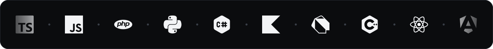
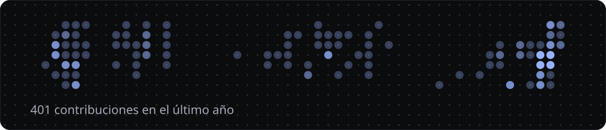

[][sitio]

### Usted conoce su negocio. Yo lo convierto en software.

Soy Adrián, ingeniero en TI y desarrollador full-stack. Hago sistemas a medida para negocios: facturación electrónica, reservas, inventario e IoT. Me adapto a lo que cada cliente necesita y saco sus ideas adelante.

IT engineer and full-stack developer. I build custom systems for businesses: electronic invoicing, bookings, inventory and IoT.

**[Ver mi trabajo en adriancarrillo.vercel.app][sitio]**

## Ahora

- Construyo el nuevo POS de Optimuz, en Flutter y Laravel.
- Mantengo un facturador electrónico que emite facturas reales ante el SRI.
- Abierto a proyectos freelance.

## Lo que he construido

<table>
<tr>
<td width="50%" valign="top">

[][caso-sri]

**[Facturador electrónico SRI][caso-sri]** 
Cada venta en la caja se convierte sola en una factura autorizada por el SRI, sin duplicados. 
Laravel, React, PostgreSQL, Docker

</td>
<td width="50%" valign="top">

[][caso-taxibocarchi]

**[TAXIBOCARCHI][caso-taxibocarchi]** 
Cuenta cuánta gente espera el taxi en una parada rural y avisa a los conductores. Solo envía un número, nunca una imagen. 
ESP32-S3, TinyML, NestJS, React, Firestore

</td>
</tr>
</table>
<table>
<tr>
<td width="50%" valign="top">

[][caso-aurum]

**[Aurum VIP Club][caso-aurum]** 
La web de un club de eventos: reservas en 3 pasos con anticipo y un bot de WhatsApp propio. En producción. 
NestJS, React, PostgreSQL, Tailwind

</td>
<td width="50%" valign="top">

[][caso-tienda]

**[Sistema para tienda de ropa][caso-tienda]** 
Inventario, ventas y apartados con abonos para una tienda de ropa. Funciona sin internet. 
Electron, React, TypeScript, SQLite

</td>
</tr>
</table>

## Con qué lo construyo

Ver la lista completa

 

| | |
|---|---|
| **Lenguajes** | TypeScript, JavaScript, PHP, Python, C#, Kotlin, Dart, C++ |
| **Frontend y móvil** | React, Angular, Vue, Tailwind, Flutter, Electron |
| **Backend y datos** | Node.js, NestJS, Laravel, Flask, PostgreSQL, MySQL, SQLite, Firebase |
| **Infraestructura y hardware** | Docker, Linux, nginx, Git, Azure, ESP32, Arduino, Cisco |

## Actividad

## Hablemos

¿Tiene un sistema en mente? Cuénteme qué necesita y le respondo con un plan claro.

**[Escríbame por WhatsApp][whatsapp]** &nbsp;·&nbsp; [danilocarrillo1515@gmail.com][correo] &nbsp;·&nbsp; [LinkedIn][linkedin]

<!--
  Todas las direcciones están aquí abajo. Al comprar el dominio propio,
  basta con reemplazar «adriancarrillo.vercel.app» en este bloque y en el texto del enlace de arriba.
-->

[sitio]: https://adriancarrillo.vercel.app
[caso-sri]: https://adriancarrillo.vercel.app/proyectos/facturador-sri/
[caso-taxibocarchi]: https://adriancarrillo.vercel.app/proyectos/taxibocarchi/
[caso-aurum]: https://adriancarrillo.vercel.app/proyectos/aurum-vip-club/
[caso-tienda]: https://adriancarrillo.vercel.app/proyectos/sistema-tienda/
[whatsapp]: https://wa.me/593994687341?text=Hola%20Adri%C3%A1n%2C%20vi%20su%20perfil%20de%20GitHub%20y%20quisiera%20hablar%20de%20un%20proyecto.
[correo]: mailto:danilocarrillo1515@gmail.com
[linkedin]: https://www.linkedin.com/in/adrian-carrillo-33a75a394/
